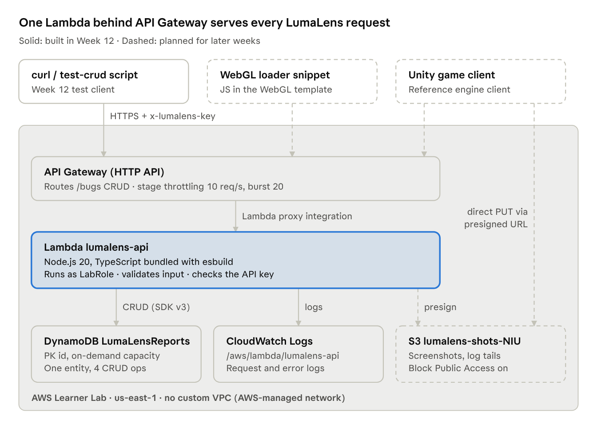

# LumaLens

Engine-agnostic bug capture for game builds: a small serverless API that game builds and test scripts post bug reports to, so errors that only appear in builds (not the editor) get recorded with their engine, platform, and build context. Cloud Computing course project (AWS Learner Lab, Track C Serverless).



More detail: [docs/architecture.md](docs/architecture.md) · API contract: [docs/openapi.yaml](docs/openapi.yaml)

## Stack

- **API Gateway HTTP API** (payload format 2.0, Lambda proxy integration), `us-east-1`
- **AWS Lambda** `lumalens-api`: Node.js 20, TypeScript bundled with esbuild, handler `index.handler`, runs as the Learner Lab `LabRole`
- **DynamoDB** table `LumaLensReports` (partition key `id`, on-demand)
- **CloudWatch Logs** for request and error logs
- **zod** for validation, **AWS SDK v3** (`@aws-sdk/lib-dynamodb`) for data access, **vitest** + **aws-sdk-client-mock** for tests
- Auth: header `x-lumalens-key` must match the Lambda env var `LUMALENS_KEY`

## BugReport

| Field | Type | Rules |
|---|---|---|
| `id` | string | UUID, set by the server |
| `title` | string | required, 1–120 chars |
| `description` | string | optional, max 2000 chars |
| `severity` | enum | `low`, `medium`, `high`, `crash` (required) |
| `status` | enum | `open`, `in_progress`, `fixed`, `wontfix`; default `open` |
| `source` | enum | `manual`, `auto`; default `manual` |
| `engine` | enum | `unity`, `godot`, `unreal`, `web` (required) |
| `runContext` | enum | `editor`, `build` (required) |
| `buildVersion` | string | required, max 32 chars |
| `platform` | enum | `windows`, `webgl`, `android`, `linux`, `mac` (required) |
| `scene` | string | optional, max 120 chars |
| `posX`, `posY`, `posZ` | number | optional |
| `coordSpace` | enum | `2d`, `3d`; optional |
| `envSnapshot` | object | optional, free-form |
| `logKey`, `screenshotKey` | string | optional |
| `createdAt`, `updatedAt` | string | ISO 8601, set by the server |

Create bodies are strict: unknown fields and client-sent `id`/`createdAt`/`updatedAt` are rejected. Updates accept only `status`, `severity` and `description`, and need at least one of them.

## Routes

Every route requires the `x-lumalens-key` header (401 if missing or wrong).

| Method | Path | Success | Errors |
|---|---|---|---|
| `POST` | `/bugs` | 201 + created item | 400 `invalid_json` / `validation_failed` |
| `GET` | `/bugs` | 200 `{ items, count }`, newest first, max 500. Optional `?status=` and `?buildVersion=` filters | 400 `validation_failed` |
| `GET` | `/bugs/{id}` | 200 item | 404 `not_found` |
| `PUT` | `/bugs/{id}` | 200 updated item | 400, 404 |
| `DELETE` | `/bugs/{id}` | 204, empty body | 404 |

Unknown routes return 404. Unexpected errors return 500 `{"error":"internal_error"}` and are logged to CloudWatch.

## Local setup

Requires Node.js 20 or newer. Run from PowerShell (or any shell):

```powershell
cd backend
npm ci
npm test            # vitest unit tests (DynamoDB is mocked, no AWS calls)
npm run typecheck   # tsc --noEmit, strict
npm run build       # -> backend/dist/index.js and backend/dist/function.zip
```

To lint the OpenAPI contract, from the repo root:

```powershell
npm ci
npm run lint:openapi
```

## Deploy (Learner Lab)

TODO: next step. Upload `backend/dist/function.zip` to the `lumalens-api` Lambda (Node.js 20, handler `index.handler`, role `LabRole`, env vars `TABLE_NAME` and `LUMALENS_KEY`), then create the `LumaLensReports` table and the HTTP API routes.
