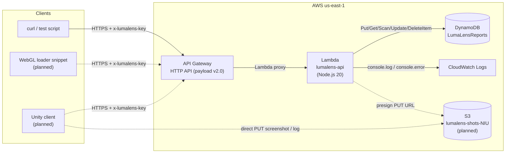

# LumaLens architecture




Solid lines exist today; dashed lines are planned for later weeks.

## Request / data flow

1. A client sends an HTTPS request to the API Gateway HTTP API with the header `x-lumalens-key`.
2. API Gateway forwards the request to the `lumalens-api` Lambda with a payload format 2.0 proxy integration.
3. The Lambda checks the API key against the `LUMALENS_KEY` env var using a constant-time compare and returns 401 if it is missing or wrong.
4. The Lambda routes on method and path (`POST/GET /bugs`, `GET/PUT/DELETE /bugs/{id}`), validates the body with zod, and calls DynamoDB through `DynamoDBDocumentClient`. The table name comes from the `TABLE_NAME` env var.
5. The response goes back through API Gateway as JSON. Unexpected errors are written to CloudWatch Logs with `console.error`, and the client only gets `{"error":"internal_error"}`.
6. Planned: the Lambda presigns an S3 PUT URL, and the Unity client uploads screenshots and logs straight to `lumalens-shots-NIU`. Only the object keys (`screenshotKey`, `logKey`) are stored on the report.

## IAM

**Actual:** AWS Academy Learner Lab can't create IAM roles, so the Lambda runs as the existing **LabRole**. LabRole is much broader than the function needs.

**Intended least privilege**, which is what we would attach in a normal account:

```json
{
  "Version": "2012-10-17",
  "Statement": [
    {
      "Effect": "Allow",
      "Action": [
        "dynamodb:PutItem",
        "dynamodb:GetItem",
        "dynamodb:Scan",
        "dynamodb:UpdateItem",
        "dynamodb:DeleteItem"
      ],
      "Resource": "arn:aws:dynamodb:us-east-1:<account-id>:table/LumaLensReports"
    },
    {
      "Effect": "Allow",
      "Action": "s3:PutObject",
      "Resource": [
        "arn:aws:s3:::lumalens-shots-NIU/screenshots/*",
        "arn:aws:s3:::lumalens-shots-NIU/logs/*"
      ]
    }
  ]
}
```

It would also need the standard CloudWatch Logs write permissions (`AWSLambdaBasicExecutionRole`).

## Network

- **No custom VPC, on purpose.** The Lambda runs in the AWS-managed network. Putting it in a VPC would mean paying for a NAT Gateway (or adding VPC endpoints) to reach DynamoDB and S3, and this project gains nothing from that.
- **TLS** terminates at API Gateway. Clients only ever talk HTTPS.
- **Throttling:** stage-level limit of 10 requests/s with a burst of 20.
- **CORS** isn't configured yet. It will only be needed once the WebGL loader snippet calls the API from a browser.
