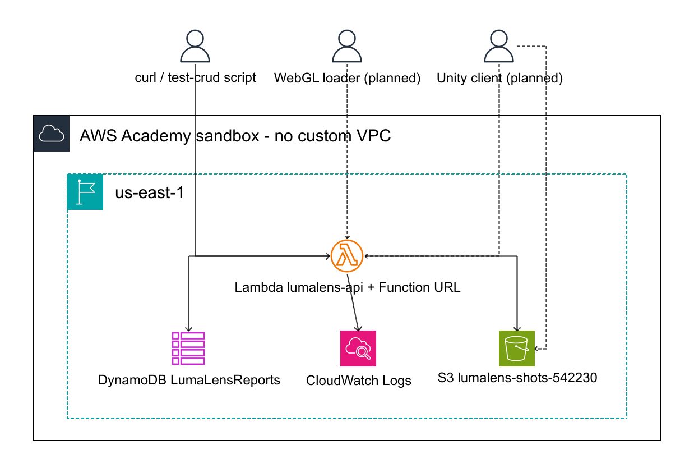

# LumaLens architecture



The PNG is generated with [AWS Diagram-as-Code](https://github.com/awslabs/diagram-as-code) from [`architecture.dac.yaml`](architecture.dac.yaml). Edit the YAML and run `awsdac architecture.dac.yaml -o architecture.png` (from `docs/`) to regenerate it.

```mermaid
flowchart LR
    subgraph Clients
        CURL["curl / test script"]
        WEBGL["WebGL loader snippet<br/>(planned)"]
        UNITY["Unity client<br/>(planned)"]
    end

    subgraph AWS["AWS us-east-1"]
        URL["Lambda Function URL<br/>(payload v2.0, auth NONE)"]
        LAMBDA["Lambda<br/>lumalens-api<br/>(Node.js 20, LabRole)"]
        DDB[("DynamoDB<br/>LumaLensReports")]
        CFN["CloudFormation<br/>lumalens-table, lumalens-bucket"]
        CW["CloudWatch Logs"]
        S3[("S3<br/>lumalens-shots-542230<br/>(private, SSE-S3)")]
    end

    CURL -->|HTTPS + x-lumalens-key| URL
    WEBGL -.->|HTTPS + x-lumalens-key| URL
    UNITY -.->|HTTPS + x-lumalens-key| URL
    URL -->|invoke| LAMBDA
    CFN -->|creates, as LabRole| DDB
    CFN -->|creates, as LabRole| S3
    LAMBDA -->|Put/Get/Scan/Update/DeleteItem| DDB
    LAMBDA -->|console.log / console.error| CW
    LAMBDA -->|presign PutObject URL<br/>(POST /uploads)| S3
    CURL -->|PUT screenshot / log<br/>to presigned URL| S3
    UNITY -.->|PUT screenshot / log<br/>to presigned URL| S3
```

Solid lines exist today; dashed lines are planned for later weeks (the Unity client and the WebGL snippet). The S3 bucket and `POST /uploads` were added in Week 13; the presign step is a local signing operation in the Lambda, not a call to S3.

## Deployed vs intended front door

The intended front door is an **API Gateway HTTP API** (payload format 2.0, 6 routes, stage throttling 10 req/s, burst 20). The AWS Academy Cloud Foundations sandbox this project is deployed in denies `apigateway:POST`, for the sandbox user and for LabRole alike, so the deployed system uses a **Lambda Function URL** instead.

Both deliver the same payload format 2.0 event, and the handler routes on `rawPath` and `requestContext.http.method`, so the code is identical behind either. Swapping back to API Gateway is a console-only change.

The sandbox user also can't call `dynamodb:CreateTable`. CloudFormation running as LabRole can, so the table comes from [`infra/dynamodb-table.yaml`](../infra/dynamodb-table.yaml), deployed as stack `lumalens-table`. The bucket comes from [`infra/s3-bucket.yaml`](../infra/s3-bucket.yaml), deployed the same way as stack `lumalens-bucket` (verified in the sandbox on 26 Nov 2026).

## Request / data flow

1. A client sends an HTTPS request to the Lambda Function URL with the header `x-lumalens-key`.
2. The Function URL invokes the `lumalens-api` Lambda with a payload format 2.0 event (the same shape an HTTP API proxy integration sends).
3. The Lambda checks the API key against the `LUMALENS_KEY` env var using a constant-time compare and returns 401 if it is missing or wrong.
4. The Lambda routes on method and path (`POST/GET /bugs`, `GET/PUT/DELETE /bugs/{id}`, `POST /uploads`), validates the body with zod, and calls DynamoDB through `DynamoDBDocumentClient`. The table name comes from the `TABLE_NAME` env var.
5. The response goes back through the Function URL as JSON. Unexpected errors are written to CloudWatch Logs with `console.error`, and the client only gets `{"error":"internal_error"}`.
6. Uploads: `POST /uploads` `{ bugId, kind }` checks the bug exists, then presigns a PutObject URL for `screenshots/<bugId>.png` (`image/png`) or `logs/<bugId>.txt` (`text/plain`), valid for 300 s, with `Content-Type` signed. The bucket name comes from the `BUCKET_NAME` env var. The client PUTs the file straight to `lumalens-shots-542230` (the bytes never pass through the Lambda), then stores the key on the report with `PUT /bugs/{id}` (`screenshotKey`, `logKey`). Only the object keys are stored in DynamoDB.

## S3 bucket

`lumalens-shots-542230` ([`infra/s3-bucket.yaml`](../infra/s3-bucket.yaml)):

- **Private:** Block Public Access on (all four settings), ACLs disabled (bucket owner enforced). The only way in from outside is a presigned URL.
- **Encryption:** default SSE-S3 (AES256).
- **Lifecycle:** objects under `logs/` expire after 30 days; incomplete multipart uploads are aborted after 1 day. Screenshots are kept.
- **CORS:** `PUT` with `Content-Type` from any origin, so a browser (WebGL) build can upload. Week 14 narrows the origin to itch.io. The Week 13 demo is a native Windows build, which doesn't need CORS.
- Presigned URLs are signed with the Lambda's LabRole session credentials, so a URL also stops working when that session expires, even within its 300 s.

## IAM

**Actual:** the AWS Academy sandbox can't create IAM roles, so the Lambda runs as the existing **LabRole**. LabRole is much broader than the function needs. The Function URL is public at the AWS level (auth type `NONE`, resource policy allowing `lambda:InvokeFunctionUrl` and `lambda:InvokeFunction` via the URL); the API key check in the Lambda is what keeps strangers out.

**Intended least privilege**, which is what we would attach in a normal account:

```json
{
  "Version": "2012-10-17",
  "Statement": [
    {
      "Effect": "Allow",
      "Action": [
        "dynamodb:PutItem",
        "dynamodb:GetItem",
        "dynamodb:Scan",
        "dynamodb:UpdateItem",
        "dynamodb:DeleteItem"
      ],
      "Resource": "arn:aws:dynamodb:us-east-1:<account-id>:table/LumaLensReports"
    },
    {
      "Effect": "Allow",
      "Action": "s3:PutObject",
      "Resource": [
        "arn:aws:s3:::lumalens-shots-542230/screenshots/*",
        "arn:aws:s3:::lumalens-shots-542230/logs/*"
      ]
    }
  ]
}
```

It would also need the standard CloudWatch Logs write permissions (`AWSLambdaBasicExecutionRole`).

## Network

- **No custom VPC, on purpose.** The Lambda runs in the AWS-managed network. Putting it in a VPC would mean paying for a NAT Gateway (or adding VPC endpoints) to reach DynamoDB and S3, and this project gains nothing from that.
- **TLS** terminates at the Function URL endpoint. Clients only ever talk HTTPS.
- **Throttling:** a Function URL has no stage throttling. In the sandbox the limits are the API key, the 10 s Lambda timeout and the account's concurrency limit. With API Gateway (intended), the `$default` stage is throttled to 10 requests/s with a burst of 20.
- **CORS** is configured on the S3 bucket only (see above). The Function URL has none yet; it will be needed once the WebGL loader snippet calls the API from a browser.
